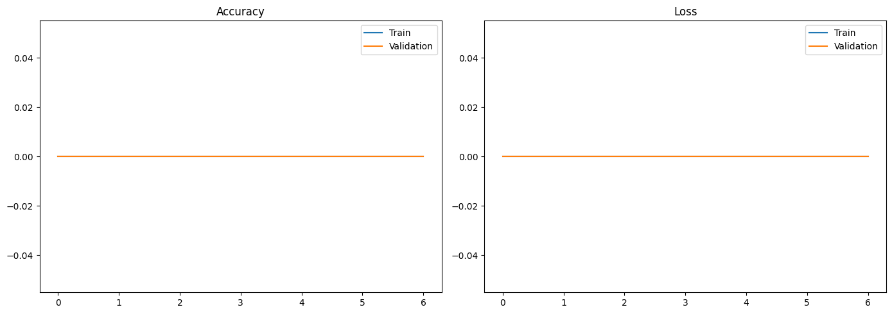
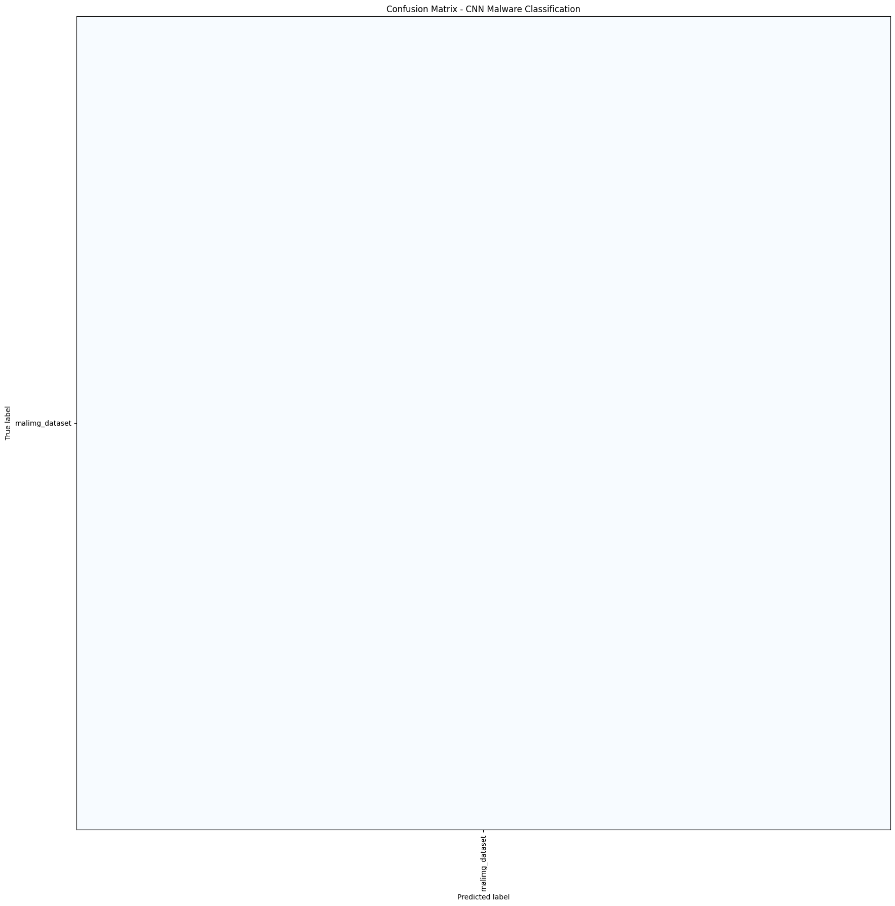

# Implementasi SCNN (Simple Convolutional Neural Network) untuk Klasifikasi Citra Malware Berdasarkan Keluarga Malware

## ABSTRAK

Malware memiliki banyak varian dan keluarga sehingga identifikasi menggunakan ciri manual menjadi sulit. Penelitian ini mengimplementasikan SCNN (*Simple Convolutional Neural Network*) untuk mengklasifikasikan citra malware berdasarkan keluarga malware menggunakan Malimg Dataset. Tahapan penelitian meliputi preprocessing, augmentasi, pelatihan SCNN, dan evaluasi menggunakan accuracy, precision, recall, F1-score, serta confusion matrix. Model menggunakan dua lapisan konvolusi sehingga mudah dipahami dan sesuai untuk eksperimen awal Computer Vision. Implementasi dilakukan pada Kaggle Notebook menggunakan TensorFlow dan GPU jika tersedia.

**Kata kunci:** Computer Vision, SCNN, CNN, image classification, malware.

## BAB I - PENDAHULUAN

### 1.1 Latar Belakang

Malware merupakan perangkat lunak berbahaya yang dapat mengganggu sistem, mencuri informasi, atau memperoleh akses tanpa izin. Jumlah keluarga malware yang terus bertambah membuat metode berbasis signature memerlukan pembaruan secara berkelanjutan.

Pendekatan berbasis citra mengubah binary malware menjadi representasi visual. Pola byte dan struktur malware kemudian diproses menggunakan computer vision. CNN dipilih karena dapat mempelajari fitur lokal citra langsung dari data melalui operasi konvolusi.

### 1.2 Rumusan Masalah

1. Bagaimana membangun SCNN untuk klasifikasi citra malware?
2. Bagaimana performa SCNN dalam mengenali keluarga malware?
3. Bagaimana hasil evaluasi model berdasarkan metrik klasifikasi?

### 1.3 Tujuan Penelitian

1. Mengimplementasikan SCNN untuk klasifikasi citra malware.
2. Mengukur kemampuan model dalam membedakan keluarga malware.
3. Menganalisis hasil prediksi menggunakan metrik evaluasi.

### 1.4 Batasan Penelitian

1. Dataset yang digunakan adalah Malimg Dataset.
2. Tugas yang dilakukan adalah klasifikasi multi-kelas.
3. Input model berupa citra grayscale berukuran 128 × 128 piksel.
4. Penelitian tidak menjalankan file malware dan tidak membahas dynamic analysis.

## BAB II - TINJAUAN PUSTAKA

### 2.1 Computer Vision

Computer vision adalah bidang kecerdasan buatan yang mempelajari cara komputer memperoleh dan memahami informasi dari citra atau video. Tahapannya meliputi akuisisi data, preprocessing, ekstraksi fitur, klasifikasi, dan evaluasi.

### 2.2 Representasi Binary Malware sebagai Citra

Binary malware terdiri atas rangkaian byte dengan nilai 0 sampai 255. Nilai byte dapat dipetakan menjadi intensitas piksel grayscale, kemudian disusun menjadi matriks dua dimensi. Pendekatan ini termasuk analisis statis karena file malware tidak dijalankan.

### 2.3 Simple Convolutional Neural Network

SCNN adalah arsitektur CNN sederhana dengan jumlah lapisan terbatas. Lapisan konvolusi mengekstraksi fitur lokal, max pooling mengurangi dimensi feature map, flatten mengubah feature map menjadi vektor, dense layer menggabungkan fitur, dan softmax menghasilkan probabilitas kelas.

Operasi konvolusi dapat dituliskan sebagai:

\[
F(i,j) = \sum_m \sum_n I(i+m,j+n)K(m,n)
\]

Fungsi aktivasi ReLU dirumuskan sebagai:

\[
ReLU(x) = max(0,x)
\]

### 2.4 Komponen Model

- **Convolutional layer:** mendeteksi pola seperti garis, tekstur, dan bentuk.
- **Max pooling:** mempertahankan fitur dominan dan mengurangi dimensi.
- **Flatten:** mengubah feature map menjadi vektor satu dimensi.
- **Dense layer:** menggabungkan fitur untuk klasifikasi.
- **Dropout:** mengurangi risiko overfitting.
- **Softmax:** menghasilkan probabilitas untuk setiap kelas.

### 2.5 Klasifikasi Multi-Kelas

Setiap folder pada Malimg Dataset dianggap sebagai satu keluarga malware. Karena jumlah kelas lebih dari dua, tugas ini termasuk klasifikasi multi-kelas. Kelas dengan probabilitas softmax terbesar menjadi hasil prediksi.

### 2.6 Data Augmentation

Data augmentation menghasilkan variasi baru dari citra training menggunakan rotasi kecil, zoom, dan translasi. Teknik ini membantu meningkatkan variasi data dan kemampuan generalisasi model.

### 2.7 Evaluasi Model

Accuracy mengukur proporsi prediksi yang benar. Precision mengukur ketepatan prediksi suatu kelas, recall mengukur kemampuan menemukan sampel suatu kelas, dan F1-score merupakan rata-rata harmonik precision serta recall. Confusion matrix menunjukkan kelas yang benar dan kelas yang tertukar.

## BAB III - METODOLOGI PENELITIAN

### 3.1 Tahapan Penelitian

```text
Malimg Dataset
      ↓
Pemeriksaan struktur dataset
      ↓
Preprocessing dan resize citra
      ↓
Pembagian training dan validation
      ↓
Augmentasi data training
      ↓
Pelatihan SCNN
      ↓
Evaluasi dan visualisasi hasil
```

### 3.2 Dataset

Dataset ditambahkan melalui menu **Add Input** pada Kaggle. Path mount yang digunakan dapat berbeda berdasarkan konfigurasi session. Notebook akan mencoba beberapa path umum, termasuk:

```text
/kaggle/input/malimg
/kaggle/input/malimg/malimg_dataset
/kaggle/input/malimg/malimg_dataset/train
```

Label kelas ditentukan berdasarkan nama folder keluarga malware. Jumlah total gambar dan kelas dicatat berdasarkan hasil pembacaan notebook setelah dataset ditemukan.

### 3.3 Preprocessing

Preprocessing yang dilakukan adalah:

1. Membaca citra dari folder kelas.
2. Mengubah citra menjadi grayscale.
3. Resize citra menjadi 128 × 128 piksel.
4. Membagi data menjadi 80% training dan 20% validation.
5. Menormalisasi nilai piksel ke rentang 0 sampai 1.
6. Membentuk batch berukuran 32.

### 3.4 Augmentasi Data

Augmentasi diterapkan hanya pada data training menggunakan:

- rotasi kecil;
- zoom;
- translasi horizontal dan vertikal.

Data validation tidak diberi augmentasi agar hasil evaluasi tetap objektif.

### 3.5 Arsitektur SCNN

Model yang digunakan adalah **SCNN (Simple Convolutional Neural Network)** dengan struktur:

```text
Input 128 × 128 × 1
        ↓
Conv2D 32 filter + ReLU
        ↓
MaxPooling
        ↓
Conv2D 64 filter + ReLU
        ↓
MaxPooling
        ↓
Flatten
        ↓
Dense 128 neuron + ReLU
        ↓
Dropout 40%
        ↓
Softmax output
```

### 3.6 Konfigurasi Training

| Komponen | Konfigurasi |
| --- | --- |
| Optimizer | Adam |
| Learning rate | 0,001 |
| Loss function | Sparse categorical crossentropy |
| Batch size | 32 |
| Maksimum epoch | 30 |
| Early stopping | Patience 6 |
| Reduce learning rate | Factor 0,3; patience 3 |
| Input | Grayscale 128 × 128 |

### 3.7 Perangkat Keras dan Perangkat Lunak

Notebook mencatat sistem operasi, prosesor, RAM, nama GPU, dan VRAM jika tersedia. Training dijalankan pada Kaggle Notebook menggunakan Python, TensorFlow, NumPy, Matplotlib, dan Scikit-learn.

GPU tidak wajib, tetapi GPU T4 ×2 disarankan untuk mempercepat training. Jika GPU tidak tersedia, proses pelatihan dijalankan menggunakan CPU.

### 3.8 Metrik Evaluasi

Notebook menghasilkan accuracy, precision macro, recall macro, F1-score macro, classification report per kelas, confusion matrix, grafik accuracy, dan grafik loss.

## BAB IV - HASIL DAN PEMBAHASAN

### 4.1 Informasi Dataset dan Hardware

Pada eksekusi notebook yang tersimpan, perangkat yang digunakan adalah:

| Komponen | Hasil |
| --- | --- |
| Sistem operasi | Linux 6.18.48+ |
| Prosesor | x86_64 |
| RAM | 31,35 GB |
| GPU | 2 × Tesla T4 |
| VRAM | 15.360 MiB per GPU |
| Dataset terbaca | 9.339 gambar |
| Kelas terbaca | 1 kelas |

Konfigurasi perangkat tersebut sudah memadai untuk menjalankan SCNN. Namun, jumlah kelas yang terbaca masih satu sehingga eksperimen harus diulang sebelum hasil akhir digunakan.

### 4.2 Grafik Training dan Validation

Gambar berikut merupakan output yang tersimpan dari notebook:





**Catatan analisis:** gambar tersebut masih merupakan hasil sementara. Pada eksekusi tersebut dataset terbaca sebagai satu kelas (`malimg_dataset`), sehingga grafik belum dapat digunakan sebagai hasil klasifikasi multi-kelas yang final. Setelah folder keluarga malware terbaca dengan benar, grafik dan confusion matrix harus diperbarui menggunakan hasil training terbaru.

Grafik accuracy dan loss digunakan untuk menilai konvergensi model. Selisih besar antara kurva training dan validation dapat menunjukkan overfitting, sedangkan nilai keduanya yang rendah dapat menunjukkan underfitting.

### 4.3 Hasil Evaluasi

Nilai evaluasi dirangkum dalam tabel `results_table` pada notebook. Berdasarkan hasil eksekusi sementara, diperoleh nilai sebagai berikut:

| Metrik | Nilai sementara |
| --- | ---: |
| Accuracy | 1,0000 |
| Precision Macro | 1,0000 |
| Recall Macro | 1,0000 |
| F1-Score Macro | 1,0000 |
| Jumlah kelas | 1 |
| Data training | 7.472 gambar |
| Data validation | 1.867 gambar |

Nilai 1,0000 tersebut tidak dapat dianggap sebagai performa klasifikasi malware karena seluruh data hanya memiliki satu label. Nilai tersebut hanya menunjukkan bahwa model memprediksi satu-satunya kelas yang tersedia.

**Pembahasan tabel:** accuracy, precision, recall, dan F1-score bernilai 1,0000 karena hanya terdapat satu kelas. Oleh sebab itu, angka tersebut belum menggambarkan kemampuan SCNN membedakan keluarga malware.

### 4.4 Konfigurasi Eksperimen

| Parameter | Nilai |
| --- | --- |
| Ukuran citra | 128 × 128 piksel |
| Mode warna | Grayscale |
| Batch size | 32 |
| Maksimum epoch | 30 |
| Optimizer | Adam |
| Learning rate awal | 0,001 |
| Early stopping patience | 6 |
| ReduceLROnPlateau patience | 3 |
| Augmentasi | Rotasi, zoom, translasi |

### 4.5 Classification Report Sementara

| Kelas | Precision | Recall | F1-score | Support |
| --- | ---: | ---: | ---: | ---: |
| malimg_dataset | 1,00 | 1,00 | 1,00 | 1.867 |
| Macro average | 1,00 | 1,00 | 1,00 | 1.867 |

Tabel ini bersifat diagnostik, bukan hasil akhir. Classification report final harus menampilkan seluruh keluarga malware setelah struktur folder dataset diperbaiki.

**Pembahasan classification report:** nilai sempurna pada kelas `malimg_dataset` terjadi karena seluruh sampel validation memiliki label yang sama. Setelah dataset terbaca dengan benar, setiap keluarga malware harus muncul sebagai baris kelas tersendiri.

### 4.6 Confusion Matrix

Confusion matrix digunakan untuk melihat prediksi benar dan kesalahan prediksi pada setiap keluarga malware. Pada hasil sementara, matrix belum dapat digunakan untuk membandingkan keluarga malware karena dataset hanya memiliki satu kelas. Pada eksperimen final, diagonal matrix menunjukkan prediksi benar, sedangkan nilai di luar diagonal menunjukkan kelas yang tertukar.

## BAB V - KESIMPULAN DAN SARAN

### 5.1 Kesimpulan

Proyek ini mengimplementasikan SCNN untuk klasifikasi citra malware berdasarkan keluarga malware menggunakan Malimg Dataset. Model menggunakan dua lapisan konvolusi, max pooling, flatten, dense layer, dropout, dan softmax. Evaluasi dilakukan menggunakan metrik klasifikasi, classification report, confusion matrix, serta grafik training dan validation.

Kesimpulan akhir ditetapkan berdasarkan hasil eksperimen setelah seluruh proses pelatihan dan evaluasi selesai.

### 5.2 Saran

1. Menggunakan transfer learning seperti ResNet atau EfficientNet.
2. Menerapkan class weight untuk mengatasi ketidakseimbangan kelas.
3. Membandingkan SCNN dengan arsitektur CNN lain.
4. Menambahkan Grad-CAM untuk interpretasi model.
5. Menguji model pada dataset malware yang berbeda.
6. Mengukur generalisasi terhadap malware yang belum pernah dilihat.

## DAFTAR PUSTAKA

1. LeCun, Y., Bottou, L., Bengio, Y., & Haffner, P. (1998). Gradient-based learning applied to document recognition. *Proceedings of the IEEE*, 86(11), 2278-2324.
2. Krizhevsky, A., Sutskever, I., & Hinton, G. E. (2012). ImageNet classification with deep convolutional neural networks. *Advances in Neural Information Processing Systems*.
3. Nataraj, L., Karthikeyan, S., Jacob, G., & Manjunath, B. S. (2011). Malware images: Visualization and automatic classification. *Proceedings of the 8th International Symposium on Visualization for Cyber Security*.

## FILE PROYEK

- `scnn-malware-classification.ipynb`: notebook utama Kaggle.
- `kernel-metadata.json`: metadata publikasi Kaggle.

Dataset tidak disimpan di GitHub karena ukurannya besar dan ditambahkan langsung melalui Kaggle.
